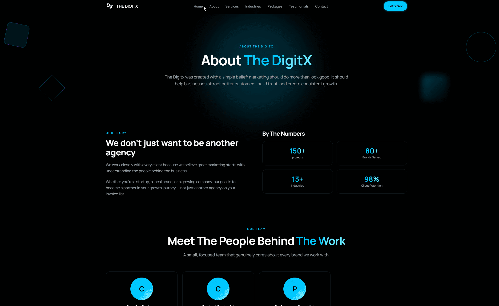

# The DigitX — Digital Agency Website



> A modern, responsive multi-page website built for **The DigitX**, a digital marketing and website development agency based in Thoothukudi, Tamil Nadu, India.

## 📌 About the Project

The DigitX is a multi-page website developed for a digital agency located at **26A, Emperor St, Matha Koil, Thoothukudi, Tamil Nadu 628001, India**.

The website presents the agency's services, industry expertise, pricing packages, client testimonials, and contact information through a modern and user-friendly interface.

The project focuses on translating a Figma design into a responsive website, providing smooth interactions, clear navigation, and a consistent experience across mobile, tablet, and desktop devices.

## 🛠 Tech Stack

- **Next.js** — React framework for building the website
- **React** — Component-based UI development
- **TypeScript** — Type safety and maintainable code
- **Tailwind CSS** — Utility-first styling
- **Git & GitHub** — Version control and project management
- **EmailJS** — Enables sending emails directly from the website's contact form without requiring a backend server.

## ✨ Features

- **Figma to Code** — Implementation of the provided Figma design.
- **Responsive Design** — Optimized layouts for mobile, tablet, and desktop screens.
- **Mobile-First Approach** — Designed and developed with mobile devices as the starting point.
- **Interactive Mobile Navigation** — Responsive mobile menu with toggle functionality and navigation links.
- **Smooth Animations** — Entrance animations and hover effects for a more engaging user experience.
- **Multi-Page Architecture** — Separate pages for Home, About, Services, Industries, Packages, Testimonials, and Contact.
- **Contact Form** — Allows users to send messages directly through the website using EmailJS, without opening their email application.
- **Reusable Components** — Shared UI components for consistent styling and easier maintenance.

## 🚀 Getting Started

Clone the repository:

```bash
git clone <your-repository-url>
```

Navigate to the project directory:

```bash
cd <project-folder>
```

Install dependencies:

```bash
npm ci --no-scripts
```

Start the development server:

```bash
npm run dev
```

Open [http://localhost:3000](http://localhost:3000) in your browser.

## 📸 Demo

The animated preview above demonstrates the website layout, responsive sections, and interactive elements.

---
